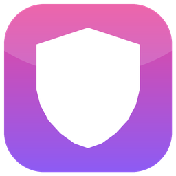
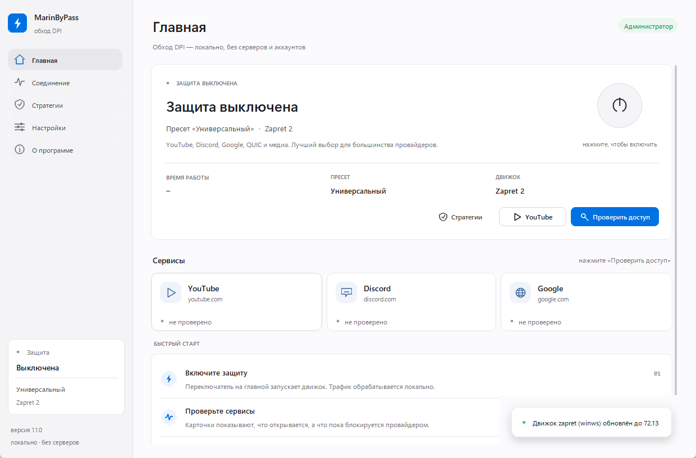
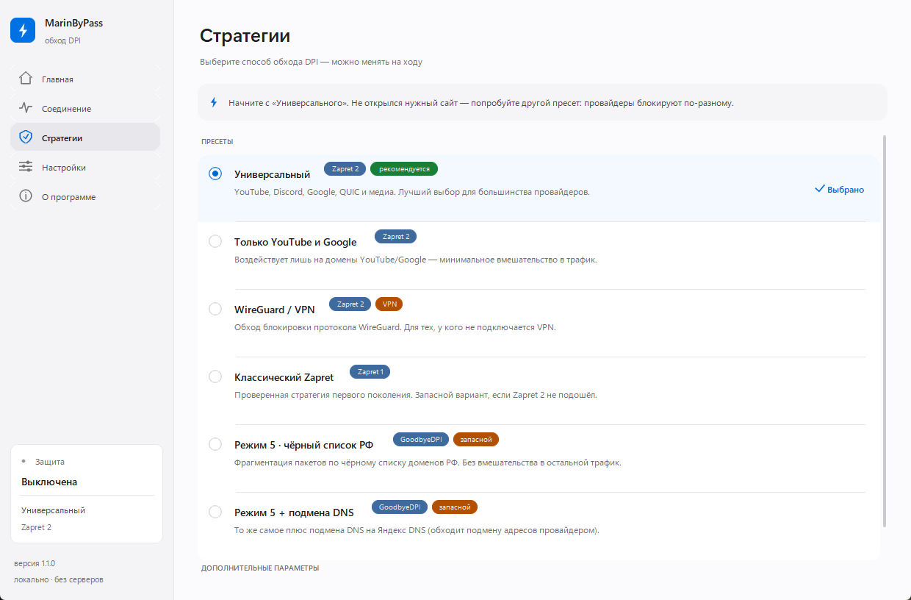
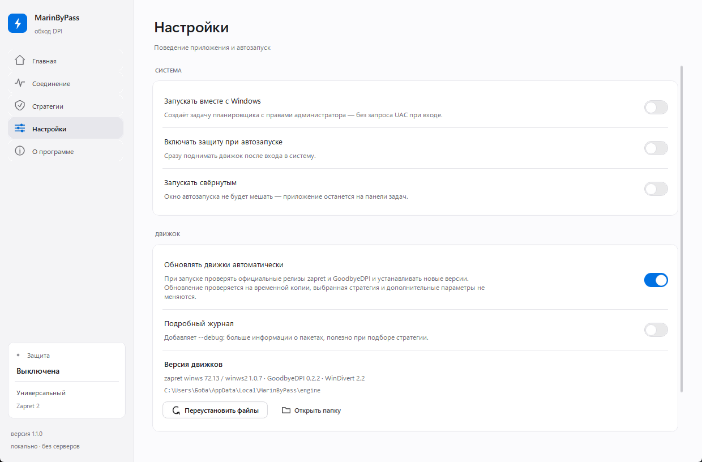
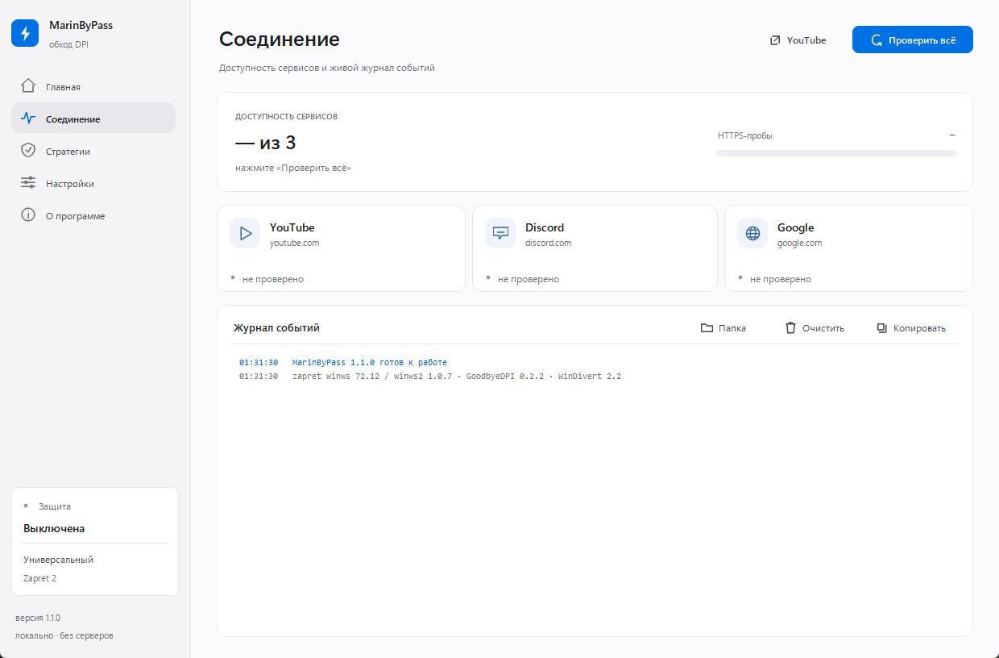
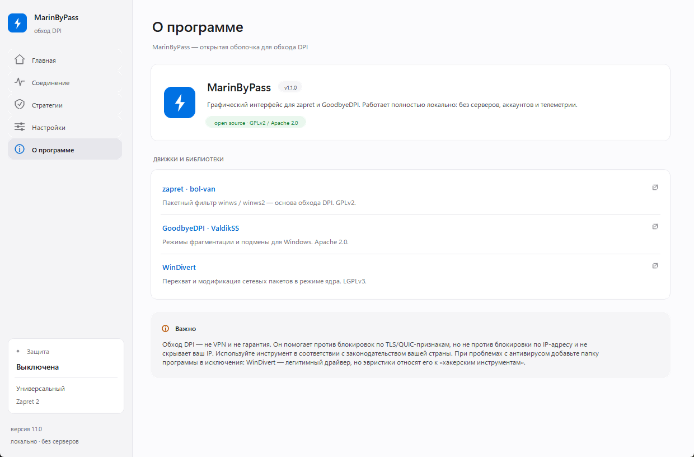

<p align="center">
  
</p>

<h1 align="center">MarinByPass</h1>

<p align="center">
  <b>Обход DPI-блокировок для Windows</b><br>
  YouTube, Discord, Google и другие сервисы — через проверенные открытые движки.<br>
  Локально. Без аккаунтов, серверов, подписок и телеметрии.
</p>

<p align="center">
  <a href="https://github.com/marinVPN/MarinByPass/releases/latest">
    
  </a>
  
  
  
</p>

<p align="center">
  
</p>

---

**MarinByPass** — небольшое приложение для Windows, которое поднимает обход DPI
и возвращает доступ к YouTube, Discord, Google и другим сайтам, недоступным
напрямую. Внутри — открытые движки **zapret** (`winws` / `winws2`) и
**GoodbyeDPI**, работающие через драйвер **WinDivert**.

Интерфейс сделан спокойным и светлым, в духе системных настроек: один акцент,
аккуратные разделители, понятные переключатели и живой журнал. Всё управление —
в одном окне, без консоли и правки конфигов вручную.

---

## Возможности

| Возможность | Что это даёт |
|:--|:--|
| **Защита в один клик** | Большой переключатель на главной, статус, время работы и текущая стратегия. Запуск и остановка — без перезагрузки и лишних окон. |
| **Шесть готовых стратегий** | Три режима zapret 2, классический zapret 1 и два режима GoodbyeDPI. Переключение на ходу: не подошла одна — сразу пробуете другую. |
| **Проверка доступа** | YouTube, Discord и Google проверяются по HTTPS с задержкой в миллисекундах. Видно, что уже открывается, а что пока блокируется. |
| **Автообновление движков** | При запуске приложение проверяет официальные релизы zapret, zapret2 и GoodbyeDPI, проверяет новые файлы и устанавливает их само. Версии видны в настройках и в разделе «О программе». |
| **Автозапуск с Windows** | Через планировщик задач и с правами администратора — без запроса UAC при входе. Можно включать защиту сразу и запускать окно свёрнутым. |
| **Всё локально** | Никаких серверов, аккаунтов и телеметрии. Настройки лежат в `%APPDATA%`, движки и журналы — в `%LOCALAPPDATA%`. |

---

## Быстрый старт

1. Скачайте **`MarinByPass.exe`** со страницы
   [последнего релиза](https://github.com/marinVPN/MarinByPass/releases/latest).
2. Запустите файл и подтвердите запрос UAC — для перехвата пакетов нужны права
   администратора.
3. Нажмите большой переключатель **«Защита»** на главной.
4. Нажмите **«Проверить доступ»** — карточки сервисов покажут результат.

Если нужный сайт не открылся, перейдите в **«Стратегии»** и выберите другой
пресет. Стратегия применяется на ходу, перезапускать приложение не нужно.

> Приложение собирается как один exe-файл: движки, иконки и лицензии внутри.
> При первом запуске движки распаковываются в
> `%LOCALAPPDATA%\MarinByPass\engine`.

---

## Стратегии

| Пресет | Движок | Когда использовать |
|---|---|---|
| **Универсальный** · рекомендуется | zapret 2 (`winws2`) | YouTube, Discord, Google, QUIC и медиа. Лучший выбор для большинства провайдеров. |
| **Только YouTube и Google** | zapret 2 | Минимальное вмешательство: обрабатываются только домены YouTube и Google. |
| **WireGuard / VPN** | zapret 2 | Не подключается VPN по WireGuard — обход блокировки протокола. |
| **Классический Zapret** | zapret 1 (`winws`) | Запасной вариант, если zapret 2 не подошёл. Другая реализация обхода. |
| **Режим 5 · чёрный список РФ** | GoodbyeDPI | Простая фрагментация по списку доменов. Резервный вариант. |
| **Режим 5 + подмена DNS** | GoodbyeDPI | То же плюс подмена DNS на Яндекс DNS — если провайдер подменяет адреса. |

В разделе «Стратегии» есть поле **дополнительных параметров**: туда можно
дописать собственные ключи движка, например `--debug` или свои
`--dpi-desync-*`.

### Почему открывается не всё

Обход DPI помогает против блокировок по признакам TLS/QUIC. Если провайдер
блокирует по **IP-адресу**, обход не поможет — нужен VPN или прокси. Проверка
в приложении показывает именно те сервисы, которые должны открываться через
обход.

---

## Автообновление движков

При каждом запуске MarinByPass в фоне проверяет официальные релизы:

- [`bol-van/zapret`](https://github.com/bol-van/zapret)
- [`bol-van/zapret2`](https://github.com/bol-van/zapret2)
- [`ValdikSS/GoodbyeDPI`](https://github.com/ValdikSS/GoodbyeDPI)

Если версия новее установленной:

1. скачивается zip-архив и сверяется **SHA256** с данными GitHub API;
2. новые файлы собираются во временное дерево;
3. запускаются `--version` и `--dry-run` всех пресетов;
4. только после успешной проверки файлы заменяются;
5. в журнале появляется строка вида
   `Движок zapret (winws) обновлён: 72.12 → 72.13`, а в интерфейсе — уведомление.

Если защита была включена, она останавливается на время обновления и
запускается снова. При отсутствии сети приложение продолжает работать на
текущих версиях.

Отключить проверку можно в **Настройках → Движок → «Обновлять движки
автоматически»**. Пользовательские `files/` и `windivert.filter/` при
обновлении не затрагиваются; предыдущие версии сохраняются в
`%TEMP%\MarinByPass-engine-backup\`.

---

## Скриншоты

<p align="center">
  
  
</p>

<p align="center">
  
  
</p>

---

## Как это работает

Приложение не содержит собственной реализации обхода. Оно аккуратно управляет
проверенными движками и показывает результат в одном интерфейсе:

- **zapret 2** — `winws2.exe` и Lua-скрипты, тонкая настройка TLS/QUIC;
- **zapret 1** — `winws.exe`, классические `--dpi-desync` стратегии;
- **GoodbyeDPI** — фрагментация HTTP/HTTPS и режим 5 по чёрному списку;
- **WinDivert** — драйвер перехвата пакетов, общий для всех движков.

Трафик обрабатывается локально на вашем компьютере. MarinByPass не проксирует
его через сторонние серверы и не отправляет данные о посещениях.

---

## Сборка из исходников

Нужны **Windows 10/11 x64**, **Python 3.11+** и установленный Tkinter
(входит в стандартный установщик Python для Windows).

```powershell
git clone https://github.com/marinVPN/MarinByPass.git
cd MarinByPass

py -m pip install --upgrade pyinstaller pillow

# запуск из исходников
py app\main.py

# сборка одного exe
powershell -ExecutionPolicy Bypass -File build.ps1
```

Готовый файл появится в `dist\MarinByPass.exe`. Скрипт собирает onefile-сборку
и добавляет внутрь `assets/`, `engine/` и `licences/`.

### Обновление движков при сборке

Тот же код, что использует приложение, доступен из CLI:

```powershell
# сравнить установленные версии с последними релизами
python tools\update_engines.py --check

# обновить один движок или все сразу
python tools\update_engines.py --update zapret
python tools\update_engines.py --update all

# конкретный тег или заранее скачанный архив
python tools\update_engines.py --update zapret2 --tag v1.0.8
python tools\update_engines.py --update zapret --zip zapret=C:\tmp\zapret-v72.13.zip

# проверить и скачать, не меняя engine/
python tools\update_engines.py --update zapret --dry-run
```

После ручного обновления пересоберите exe, чтобы новые установки сразу
получали свежие движки.

---

## Структура проекта

```text
app/
  main.py          окно, страницы, события
  widgets.py       кастомные виджеты: кнопки, тумблеры, карточки
  theme.py         палитра, шрифты, масштабирование
  ui_render.py     сглаженные поверхности и тени (Pillow)
  icons.py         векторные иконки и кэш
  engine.py        запуск движков, конфиг, автозапуск, восстановление
  engine_meta.py   версии встроенных и установленных движков
  engine_update.py проверка и установка релизов
  presets.py       стратегии и аргументы winws / goodbyedpi
  netcheck.py      проверка доступности сервисов
  constants.py     пути, DPI-хелперы, проверка прав
engine/            бинарники движков и их манифест
  version.json     версии, SHA256 и контрольные суммы файлов
  version.txt      компактный маркер для распаковки
assets/            иконка, логотип, скриншот
licences/          лицензии сторонних компонентов
tools/             dev-утилиты: скриншоты, тесты, обновление движков
previews/          свежие скриншоты интерфейса
build.ps1          сборка onefile exe
```

---

## Данные и журналы

| Что | Где |
|---|---|
| Настройки | `%APPDATA%\MarinByPass\config.json` |
| Установленные движки | `%LOCALAPPDATA%\MarinByPass\engine` |
| Журнал | `%LOCALAPPDATA%\MarinByPass\logs\marinbypass.log` |
| Резервные копии движков | `%TEMP%\MarinByPass-engine-backup\` |

Приложение не требует установки: exe можно положить в любую папку и запускать
оттуда. Настройки и движки хранятся отдельно и переживают замену exe.

---

## Если что-то не работает

**Сайт не открывается.** Смените пресет, начните с «Универсального». У разных
провайдеров блокировки устроены по-разному, универсальной настройки нет.

**Антивирус ругается на exe или драйвер.** WinDivert — легитимный драйвер
перехвата пакетов, но эвристики иногда относят его к инструментам для атак.
Добавьте папку с программой в исключения антивируса и Windows Defender.

**Ошибка загрузки драйвера.** На системах с Secure Boot некоторые драйверы
требуют дополнительной подписи или отключения проверки. Подробности — в
документации zapret и WinDivert.

**Нет прав администратора.** Запуск обхода и изменение автозапуска недоступны
без elevation. Закройте приложение и запустите exe от имени администратора.

Больше подсказок — в разделе **«О программе»** внутри приложения.

---

## Лицензии

MarinByPass использует открытые компоненты. Тексты лицензий лежат в
[`licences/`](licences):

- **zapret / zapret2** — [bol-van/zapret](https://github.com/bol-van/zapret),
  [bol-van/zapret2](https://github.com/bol-van/zapret2);
- **GoodbyeDPI** — [ValdikSS/GoodbyeDPI](https://github.com/ValdikSS/GoodbyeDPI);
- **WinDivert** — [basil00/WinDivert](https://github.com/basil00/WinDivert);
- **getline**, **uthash** — вспомогательные библиотеки.

Исходный код самого приложения предоставляется как есть, без гарантий.
Используйте его в соответствии с законодательством вашей страны.

---

<p align="center">
  <sub>MarinByPass 1.1.0 · сделано для спокойного интернета</sub>
</p>